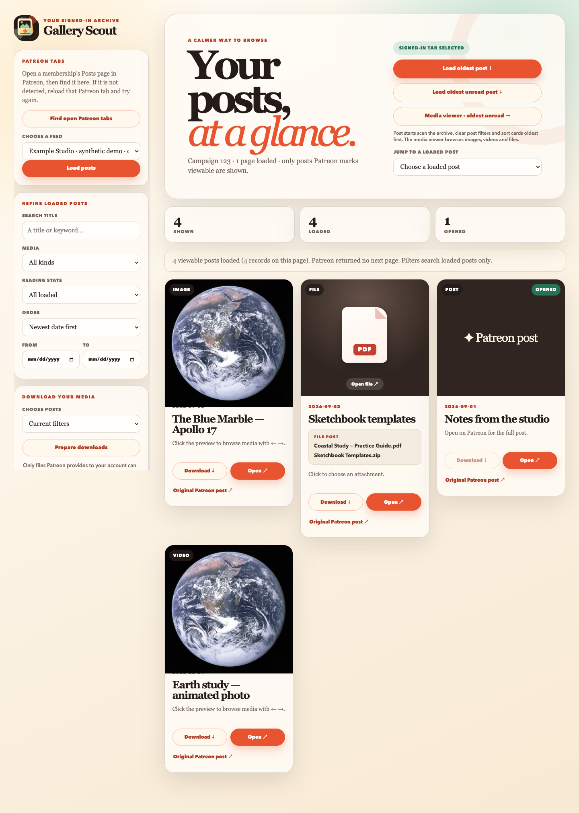
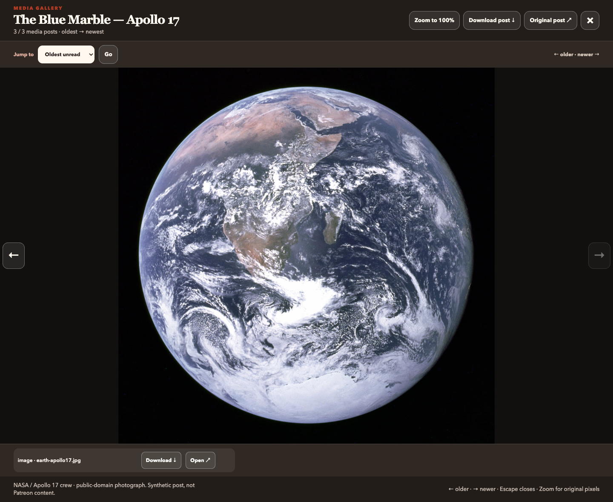
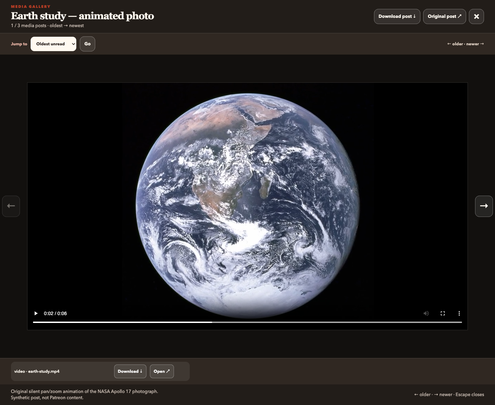
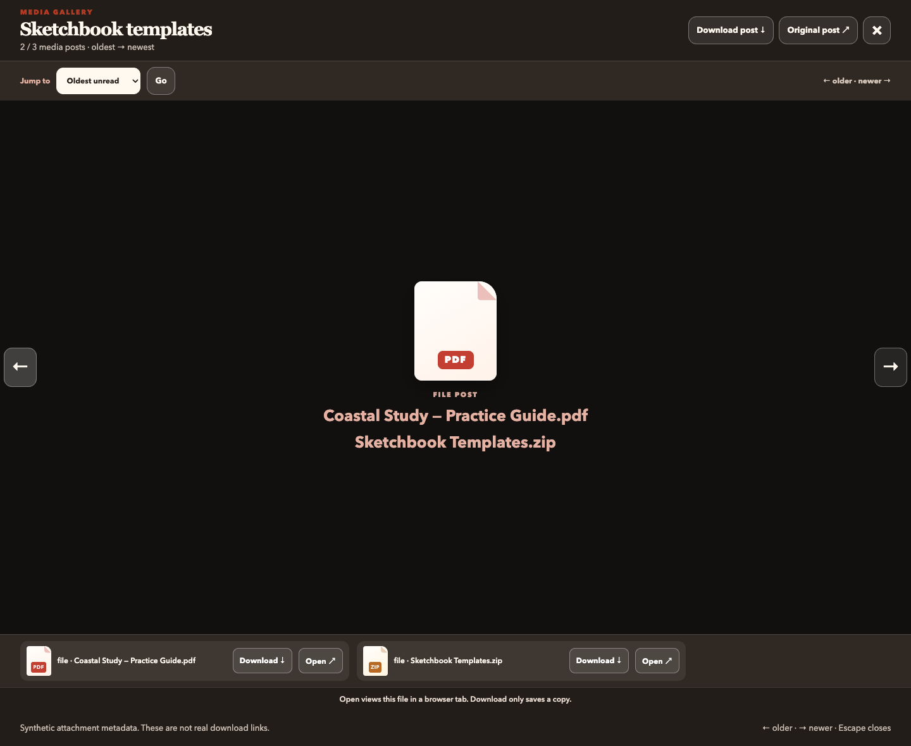

# Gallery Scout for Patreon

An unofficial, local Chrome extension for browsing posts and media available through **your signed-in Patreon memberships**. Start at the oldest post or oldest unread post, browse media chronologically, and save files where you have permission.

**Experimental beta.** Not affiliated with or endorsed by Patreon, YouTube or Vimeo. Uses undocumented Patreon website APIs and can stop working without notice. Paid access is not blanket permission to download or redistribute content. Read the [access risks](docs/ACCESS-RISKS.md), [privacy policy](docs/PRIVACY.md), and [permissions/security audit](docs/SECURITY-AUDIT.md) before installing.

**Start here:** [Install](#install-in-chrome) → [First use](#first-use-load-your-membership) → [Browse](#browse) → [Open and Download](#open-and-download). Having trouble? See [Troubleshooting](#troubleshooting).

### Main gallery preview



*All screenshots below show the real extension interface with synthetic posts. The image is NASA's public-domain Apollo 17 photograph; the video is a short animation made from that photograph. They contain no paid creator content, signed media URLs or account information, and are not evidence of live Patreon compatibility. See [example media credits](docs/examples/README.md).*

## Install in Chrome

**Requirements:** desktop Google Chrome, and a Patreon account that can view the desired posts. There is no Chrome Web Store install. No Python server, Node.js installation, OAuth registration, password handoff or cookie export is needed to **use** the extension.

### 1. Get and extract the extension

Choose **one** source:

| Source | What to download | Folder to select in Chrome |
| --- | --- | --- |
| Packaged release, **if available** | A `gallery-scout-<version>.zip` asset from [GitHub Releases](https://github.com/spkane/patreon-gallery/releases); extract it | The extracted folder containing `manifest.json` directly |
| Repository ZIP | On the [repository page](https://github.com/spkane/patreon-gallery), choose **Code → Download ZIP**; extract it | The **`extension` subfolder** inside the extracted repository—not the outer `patreon-gallery-main` folder |
| Git clone | Run `git clone https://github.com/spkane/patreon-gallery.git` | `patreon-gallery/extension` |

Use only this project's source or trusted release builds. Keep the extracted folder in a permanent location: Chrome reads those files in place. A repository ZIP is **not** the same layout as a packaged extension ZIP.

### 2. Load it in Chrome

1. Enter `chrome://extensions` in Chrome's address bar.
2. Turn on **Developer mode** using the switch at the top right.
3. Click **Load unpacked**.
4. Select the folder indicated in the table above. Open it in your file manager first if necessary: **`manifest.json` must be directly inside that folder**. Do not select a ZIP file or the repository root.
5. Confirm that **Gallery Scout for Patreon** appears and is enabled. Review its [permissions](#permissions-and-privacy).
6. Click Chrome's puzzle-piece **Extensions** menu and pin Gallery Scout for convenient access.

### Update an existing install

Replace files in the same installed folder, click **Reload** on Gallery Scout's card at `chrome://extensions`, close old gallery tabs, reload the Patreon Posts tab, and open a fresh gallery. Keep the same folder path; moving/reinstalling can change the unpacked extension ID and lose local reading markers.

### Remove it

Use **Remove** on its card at `chrome://extensions`. Downloaded files remain in Chrome's Downloads folder/history; delete those separately if desired. See [Privacy](docs/PRIVACY.md) for clearing local reading markers without uninstalling.

## First use: load your membership

1. Sign into Patreon normally in the **same Chrome profile** where the extension is installed.
2. Open a creator you support and select their **Posts** page on `www.patreon.com`. Keep that tab open. A generic home page or individual post may not identify a membership feed.
3. Click the Gallery Scout extension icon. The gallery opens in a separate tab; it does not replace the Patreon tab.
4. Under **Choose feed**, select the detected membership, then click **Load posts**. The title area should identify the campaign and show loaded post counts. If a tab was selected automatically, posts may already be loaded.
5. If the dropdown is empty, return to the Patreon Posts tab, reload it, then use **Find open Patreon tabs** in the gallery. You can switch memberships by opening another creator's Posts page, finding tabs again, selecting its feed, and clicking **Load posts**.
6. Choose how to start: click an image cover for the media viewer, **Load oldest post** for the start of the complete post archive, or **Load oldest unread post** to resume your local catch-up.

Only posts Patreon explicitly marks viewable are included. Gallery Scout cannot unlock locked posts or expired memberships. A successful empty response may mean there are no accessible posts or that the undocumented API has changed.

## Browse

- Choose a detected membership/feed, then **Load posts**. If none appears, open the creator's Posts page, reload it, and choose **Find open Patreon tabs**. A generic home page or individual post may not identify a feed.
- **Load oldest post** scans the archive, clears post filters, sorts all cards oldest-first and focuses the oldest card, including text posts.
- **Load oldest unread post** does the same for the oldest post not opened in this Chrome profile; it falls back to the oldest if all are opened. Merely focusing a card does not mark it opened.
- **Media viewer · oldest unread** starts the image/video/file viewer. **← is older; → is newer**, regardless of card sort. Use its oldest/newest/unread/date jumps and Escape to close.
- Click a brown text-post cover to open the original Patreon post. Image/video covers start the viewer. File covers open a single usable file or show attachment choices.
- Filter loaded cards by title, media type, reading state and date. Ordinary search does not automatically search the whole archive.

“Unread” is local to Gallery Scout, not Patreon's read state. Archive scans have a **100-page safety limit** (normally about 2,000 posts); oldest/all may refer only to that subset. Scan progress and **Stop scanning** are shown; denial or rate limiting should not be bypassed.

### Image viewer



Click an image card's cover to open this view. Use **← / →** or the arrow buttons to browse older/newer media; choose a **Jump to** target and click **Go** to move directly. **Zoom to 100%** inspects original pixels. Press **Escape** or click **×** to return to the grid. Opening a post in Gallery Scout records a local opened marker; only focusing its card with an oldest-post jump does not.

### Video viewer



Click a supported video card's cover to view it here. Use the player's controls to play/pause, seek or enter fullscreen. This example is a real, six-second silent MP4 rendered in the viewer—not a file icon or a provider thumbnail. Inline playback depends on the media format and available URL; YouTube uses watch links, and Vimeo uses click-to-load embeds instead.

## Open and Download

**Download** queues files and does not deliberately open them. **Open** shows browser-supported formats in a tab; other formats download first, then require a second **Open downloaded file** click. Chrome may instead reveal the file for you to open manually. Server headers, browser preferences, MIME types and app availability affect the result. Only launch files you trust.

Files show their full names and type icons when Patreon supplies metadata. Missing direct URLs disable attachment actions; previews and media IDs are not downloadable files. A Chrome queue acknowledgement is **not** successful download completion—check Chrome Downloads.

**Prepare downloads** uses current filters, all accessible media, unread posts or a date range. Confirm explicitly before it starts. Files go under `Downloads/Gallery Scout/<campaign-id>/`; queues are paced and capped at 1,500 attempts. **Stop queueing** prevents further additions but does not cancel files already queued in Chrome.

### Attachment viewer



For a post with multiple attachments, click the file cover or **Open** to see the available files. Use the **Download** or **Open** button next to the specific attachment you want. These screenshot filenames and URLs are synthetic; no real file was downloaded or opened for the capture.

### YouTube and Vimeo

YouTube cannot reliably embed in extension pages (player error 153); use its watch links. Vimeo supports validated click-to-load frames. No provider-supplied HTML is executed.

Text posts can have multiple YouTube links. Each recognized link appears on its card. **Find video links** checks detail if the feed omitted the body. **Download URL list** saves a text list, not videos. The sidebar **Export YouTube URLs for yt-dlp** collects links in the selected scope and can be stopped.

Install [yt-dlp](https://github.com/yt-dlp/yt-dlp) separately, then, only for videos you are allowed to save:

```sh
yt-dlp --batch-file "/path/to/gallery-scout-youtube-list.txt"
```

Gallery Scout does not bundle or invoke that tool, bypass DRM or export Patreon cookies. Treat unlisted-video URL lists as private.

## Permissions and privacy

| Permission | Why it is used |
| --- | --- |
| `https://www.patreon.com/*` | Discover eligible tabs and read viewable posts using the signed-in website |
| `scripting` | Restore bundled content scripts on existing Patreon tabs after extension reload |
| `downloads` | Explicit download queues, completion/ownership checks, reveal downloaded files |
| `downloads.open` | A separate user-initiated attempt to open a completed file |

No `cookies`, `history`, `tabs`, native messaging, broad website access, telemetry or maintainer backend is requested/used. Media providers receive ordinary network requests; Chrome may retain signed URLs in download history. Opened-post IDs are stored locally. See [Privacy](docs/PRIVACY.md) for clearing data and [Security](SECURITY.md) for reporting.

## Troubleshooting

- **No feeds:** reload a signed-in membership Posts tab and find tabs again. Check Chrome site-access settings.
- **Stale errors after updating:** close old gallery tabs and clear old entries at `chrome://extensions`. Report errors that recur, not stored warnings alone.
- **Missing/failed media:** open the original Patreon post. The API may omit assets or return expired links. Do not bypass locked posts or rate limits.
- **Wrong oldest:** check the scan limit, loaded count and whether you chose all posts or the media-only viewer.
- **Bug reports:** include extension/Chrome versions, action taken and redacted status text in [Issues](https://github.com/spkane/patreon-gallery/issues). Do not attach tokens, cookie exports, raw HAR files, private screenshots or signed CDN URLs.

## Develop and package

Requires Node.js 22+ and Python 3.10+; the extension and static site need no dependency installation or bundler.

```sh
python3 scripts/check.py
python3 scripts/package.py
```

The package appears under `dist/`, with `manifest.json` at root and only allowlisted extension files plus license notices. ZIP generation is reproducible; binaries, caches and secrets are not source-tracked. Load source directly for local iteration.

The static project site is in `site/`. To preview it locally with the same screenshots included by the Pages workflow, run from the repository root:

```sh
mkdir -p site/screenshots
cp docs/screenshots/*.png site/screenshots/
python3 -m http.server 8080 --directory site --bind 127.0.0.1
```

Open http://127.0.0.1:8080 in your browser. The copies in `site/screenshots/` are generated preview assets; keep the source images in `docs/screenshots/`.

The Pages workflow copies those screenshots into `site/` before deploying that directory. Changes to the site, screenshot sources or Pages workflow on `main` trigger deployment. Repository setup requires **Settings → Pages → Source: GitHub Actions**. Publishing the project site does not create an extension release.

### Refresh the documentation screenshots (optional)

The screenshots use the actual gallery HTML/CSS/JavaScript with isolated mock Chrome messages; all external requests are blocked. Fixture artwork is in `docs/examples/`. To regenerate, install Playwright in a separate development environment and make it available to Node, then run:

```sh
node scripts/capture-screenshots.cjs
```

Set `PLAYWRIGHT_MODULE` to an absolute Playwright module path if it is not on Node's module lookup path; optionally set `CHROME_PATH` to a Chrome executable. This optional tool is not needed to install or use the extension, and screenshots/fixtures are excluded from the release ZIP.

Before tagging/uploading a release, follow the [release checklist](docs/RELEASE.md). CI checks tests and packaging; it does not prove paid-session compatibility or legal permission.

## Legacy OAuth demo

The root Python server and web UI are retained as an **unsupported localhost research demo**, not part of the extension or Pages deployment. Official OAuth returned an empty list for the tested paid-subscriber campaign. Do not deploy it publicly or assume it retrieves paid memberships. Its historical setup notes are in [Legacy demo](docs/LEGACY-DEMO.md); endpoint notes and subscriber investigation remain in `docs/` for development context.

## License

[Apache License 2.0](LICENSE), with [NOTICE](NOTICE). Applies to this project's code, not Patreon posts, creator media or provider content. Compatible-service names do not imply endorsement.
